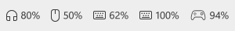

<div align="center">

# Wireless Battery · Windows Style

**Заряд беспроводных устройств — прямо на панели задач Windows.**


[](LICENSE)

[**Скачать последнюю версию**](https://github.com/unioneon/WirelessBattery-Windows-Style/releases/latest) · [English](docs/README.en.md) · [История изменений](CHANGELOG.md)

<picture>
  <source media="(prefers-color-scheme: dark)" srcset="docs/taskbar-dark.png">
  
</picture>

*Предпросмотр оформления. Проценты на изображении — пример, а не текущие показания ваших устройств.*

</div>

## Об этом форке

Это независимый **форк [Wireless Device Battery Monitor](https://github.com/krisgfx9/Wireless-Device-Battery-Monitor)** автора **[krisgfx9](https://github.com/krisgfx9)**, основанный на **[v1.0.4](https://github.com/krisgfx9/Wireless-Device-Battery-Monitor/releases/tag/v1.0.4)**.

Основное приложение, архитектура Win32 и большая часть драйверов принадлежат оригинальному проекту. Здесь доработаны внешний вид панели, отображение сохранённого заряда и поддержка конкретных клавиатур. Это отдельная сборка, не официальный релиз оригинала. Лицензия **GPL-3.0-or-later** сохранена.

## Что изменено относительно оригинальной v1.0.4

| Область | Изменения в Windows Style |
|---|---|
| **Иконки и текст** | Мягкие оттенки для светлой и тёмной темы; отрисовка шрифтов в четырёхкратном размере с усреднением покрытия для сглаживания. |
| **Геймпад** | Собственная векторная иконка: округлый корпус, четыре штриха крестовины и одно крупное кольцо. Геометрия заново отрисовывается под DPI экрана. |
| **Статус мыши** | Пропуск ответа о батарее больше не объявляет работающую мышь спящей. Последнее значение сохраняется с пометкой `last known`; достоверно сообщённый драйвером сон по-прежнему учитывается. |
| **Lofree Flow Lite84** | Добавлен протокол приёмника 2,4 ГГц: идентификация, проверка связи, процент, зарядка и напряжение; ответы проверяются по команде и контрольной сумме. |
| **AJAZZ AK820 Pro** | Добавлены запросы к приёмнику и USB-интерфейсу, правильное имя и значок по Bluetooth, единая запись при разных способах подключения. Пустой ответ не превращается в выдуманный процент. |
| **Rainy 75 Bluetooth** | Распознавание семейства Rainy 75, значок клавиатуры и имя WOBKEY Rainy 75; заряд читается из свойств Windows. |
| **WLMouse BEAST X** | Добавлен драйвер чтения процента и зарядки, включая приёмник 1K `36A7:A882`. Также распознаются модели семейства Beast X 8K и Sword X из таблицы драйвера. |
| **Проверки** | Регрессионные тесты состояния панели и драйверов клавиатур, диагностические утилиты и рендер предпросмотра. Тесты Rapoo из оригинала сохранены. |

Поддержка мышей, наушников и контроллеров из оригинальной версии сохранена. Полный исходный список устройств: [README оригинала v1.0.4](UPSTREAM-README.md).

## Проверено на устройствах

| Устройство | Подключение | Результат |
|---|---|---|
| **Rainy 75 Pro** | Bluetooth | Windows сообщает 91%; имя семейства и значок клавиатуры. 2,4 ГГц пока не поддерживается. |
| **Lofree Flow Lite84** | Приёмник 2,4 ГГц | Подтверждено чтение реального заряда; во время проверки 95–100%, также читались флаг зарядки и напряжение. |
| **AJAZZ AK820 Pro** | Bluetooth | Подтверждено чтение из Windows; во время проверки 61–62%. Правильное имя, значок клавиатуры и отсутствие дублей. |
| **WLMouse BEAST X** | Приёмник 1K `36A7:A882` | Подтверждено чтение реального заряда: 93%, без зарядки. |
| **Logitech MX Master 3S** | Logitech receiver | Чтение заряда; исправлено ложное `asleep` после пропущенного опроса. |
| **Sony WH-1000XM4** | Bluetooth | Подтверждено чтение заряда. |
| **Xbox Wireless Controller** | Bluetooth | Подтверждено отображение заряда и новой иконки. |

**AJAZZ через 2,4 ГГц — важное ограничение:** проверенный приёмник `0C45:FDFD` отвечает на запросы, но возвращает пустое значение батареи. Числовой процент по этому каналу на данной ревизии получить не удалось. По кабелю проверенный экземпляр возвращает специальный маркер `FF`; приложение показывает `USB`, а не подставляет 100%. Для процента на этой клавиатуре используйте **Bluetooth**. Поведение других ревизий не подтверждено.

Для Rainy 75 сейчас поддержан **Bluetooth**. Имена `Rainy 75-1`, `-2`, `-3` распознаются как клавиатура; Windows не различает Standard и Pro в этих именах, поэтому отображается семейство `WOBKEY Rainy 75`. При отключении Bluetooth запись убирается при следующем опросе. Запросы батареи к приёмнику `320F:5088` отключены после сбоя ввода; подробности — [исследование Rainy](docs/rainy75.md).

Если Lofree спит, нажмите на ней несколько клавиш и выберите **Refresh now**. После успешного чтения последнее значение сохраняется до 30 минут при пропусках ответов.

## Установка

Откройте [Releases](https://github.com/unioneon/WirelessBattery-Windows-Style/releases/latest):

- **Setup.exe** — установка и удаление обычным способом, ярлык в меню «Пуск».
- **portable.zip** — распакуйте архив целиком и запустите `WirelessBattery.exe`.

Перед сменой сборки закройте работающую программу через **Exit**. Для строки с иконками и процентами выберите **Show on the taskbar (icon + percentage)**. Через меню также доступны **Refresh now**, скрытие отдельных устройств и **Start with Windows**.

HeadsetControl 4.3.0 входит в выпуск для дополнительной поддержки гарнитур. Его исходники и уведомление о лицензии предоставляются вместе с релизом.

## Сборка и тесты

Нужны Windows и MinGW-w64: `g++`, `windres`, а для `make` — GNU Make.

```sh
make
make test
```

Для обычного Windows-терминала: `build.bat`. Для установщика дополнительно нужен Inno Setup:

```powershell
powershell -File installer/build-installer.ps1 -Version 1.0.4.4
```

Команды диагностики:

```text
WirelessBattery.exe --list
WirelessBattery.exe --dump
WirelessBattery.exe --quit
```

Драйвер WLMouse перенесён из [обновлённого оригинального проекта](https://github.com/notjiccu/wireless-device-battery-monitor/blob/79705baa15412ad1f96bd7c9d3798b5d981c0d2a/src/drivers/wlmouse.cpp) с добавлением проверенного приёмника `A882`. Старый Beast X 4K (`A887` / `A888`) использует другой протокол и этим драйвером не поддерживается. Поддержка остальных моделей из таблицы драйвера локально на устройствах не проверялась.

В репозитории есть [проверки драйверов](tests), [рендер панели](tests/widget_preview.cpp) и [технические примечания](LOCAL-CHANGES.md). GitHub Actions собирает приложение, запускает тесты и создаёт установщик и переносной архив.

## Авторство и лицензия

- **Оригинальное приложение:** [krisgfx9/Wireless-Device-Battery-Monitor](https://github.com/krisgfx9/Wireless-Device-Battery-Monitor), база этого форка — тег `v1.0.4`.
- **Этот форк:** [unioneon/WirelessBattery-Windows-Style](https://github.com/unioneon/WirelessBattery-Windows-Style).
- **Протокол Lofree:** [официальный Control HUB](https://lofree.tech/home/).
- **Исследования AJAZZ:** [ak820-mac](https://github.com/gha-projects/ak820-mac) и [ak820-center](https://github.com/Twyx22/ak820-center).
- **Дополнительные гарнитуры:** [HeadsetControl](https://github.com/Sapd/HeadsetControl).

**GNU GPL v3 или более поздняя версия.** При распространении изменённых сборок необходимо сохранять лицензию и предоставлять соответствующие исходники. См. [LICENSE](LICENSE), [уведомления о стороннем ПО](installer/THIRD_PARTY_NOTICES.txt) и [благодарности оригинального проекта](UPSTREAM-README.md#credits).
