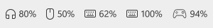

# Wireless Battery · Windows Style

[Русский](../README.md) · [Download](https://github.com/unioneon/WirelessBattery-Windows-Style/releases/latest) · [Changelog](../CHANGELOG.md)

Battery levels of wireless devices, directly on the Windows taskbar, with softer colors and clearer icons.

*Layout preview; percentages are illustrative.*

## An independent fork, with credit to the original

This project is a fork of **[krisgfx9/Wireless-Device-Battery-Monitor](https://github.com/krisgfx9/Wireless-Device-Battery-Monitor)**, based on its **v1.0.4** tag. The Win32 application, architecture and most device drivers come from that project. This fork adds the changes below; it is not an official upstream release. The **GPL-3.0-or-later** license is retained.

## Changes from upstream v1.0.4

- Softer foreground colors for light/dark taskbars and 4× grayscale supersampling for font rendering.
- A custom DPI-aware vector gamepad icon: rounded body, four D-pad bars and one larger ring.
- A missed battery poll no longer invents an `asleep` state. Cached values remain marked `last known`; explicit driver sleep states still apply.
- Lofree Flow Lite84 2.4 GHz support, including identification, online status, battery, charging and voltage, with reply/checksum validation.
- AJAZZ AK820 Pro receiver/USB queries and Bluetooth name/icon normalization, with one stable entry across transports.
- Production display-state and keyboard-driver regression tests, diagnostic tools and a taskbar preview renderer.

Mouse, headset and controller battery protocols from upstream are retained. See the [archived upstream README](../UPSTREAM-README.md) for the inherited device list.

## Hardware verification and limits

| Device | Transport | Verified result |
|---|---|---|
| Lofree Flow Lite84 | 2.4 GHz receiver | Real battery readings, 95–100% during verification; charging/voltage fields were also read. |
| AJAZZ AK820 Pro | Bluetooth | Windows battery property, 61–62% during verification; correct name/icon and transport deduplication. |
| Logitech MX Master 3S | Logitech receiver | Battery reading; false sleep display after missed polls fixed. |
| Sony WH-1000XM4 | Bluetooth | Battery reading. |
| Xbox Wireless Controller | Bluetooth | Battery display and custom gamepad icon. |

**AJAZZ radio limitation:** the tested `0C45:FDFD` receiver responds but supplies no usable battery percentage. Its USB interface returns a special `FF` wired marker, shown as `USB`, never as an invented measured 100%. Use **Bluetooth** for a percentage on this unit. Other firmware revisions have not been verified.

Sleeping Lofree keyboards may need a keypress followed by **Refresh now**. After a successful reading, the existing 30-minute last-known-value cache applies when replies are missed.

## Install

Download the installer or portable ZIP from [Releases](https://github.com/unioneon/WirelessBattery-Windows-Style/releases/latest). Exit the previous instance before switching builds. Extract the complete portable archive before running `WirelessBattery.exe`.

Select **Show on the taskbar (icon + percentage)** for the inline widget. The menu also offers per-device visibility, **Refresh now** and **Start with Windows**. HeadsetControl 4.3.0 is bundled, together with its notices and corresponding release source.

## Build

Use MinGW-w64 and GNU Make: `make`, then `make test`. Alternatively, run `build.bat`. Inno Setup is required for `installer/build-installer.ps1 -Version 1.0.4.4`. GitHub Actions builds, tests and packages the application.

Diagnostics: `--list`, `--dump`, `--quit`. See [technical notes](../LOCAL-CHANGES.md) and [contribution guidelines](../CONTRIBUTING.md).

## Credits and license

Original application: **[krisgfx9](https://github.com/krisgfx9)**. Fork: **[unioneon](https://github.com/unioneon)**. Lofree protocol: [official Control HUB](https://lofree.tech/home/). AJAZZ research: [ak820-mac](https://github.com/gha-projects/ak820-mac), [ak820-center](https://github.com/Twyx22/ak820-center). Extra headset support: [HeadsetControl](https://github.com/Sapd/HeadsetControl). The [upstream credits](../UPSTREAM-README.md#credits) acknowledge the other protocol research inherited by this fork.

Licensed under **[GNU GPL v3 or later](../LICENSE)**. Preserve the license and provide corresponding source when distributing modified builds. See [third-party notices](../installer/THIRD_PARTY_NOTICES.txt).
